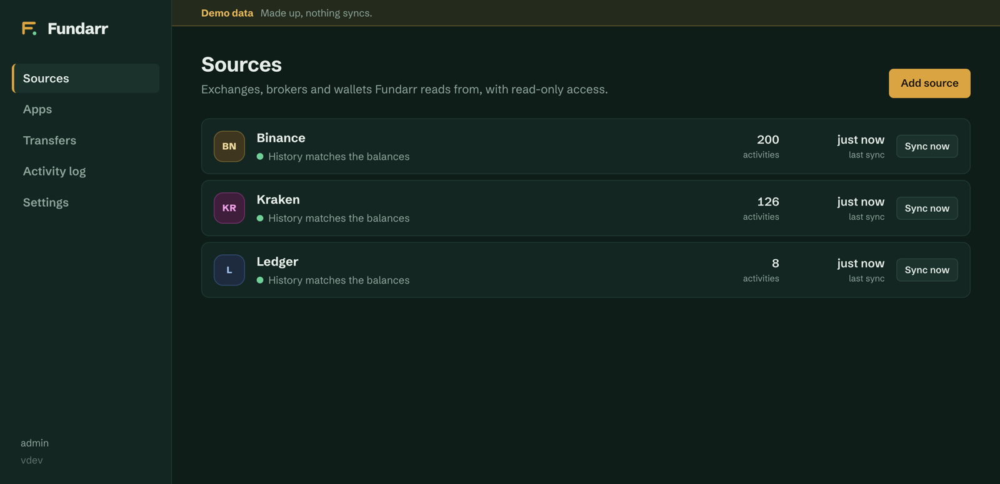
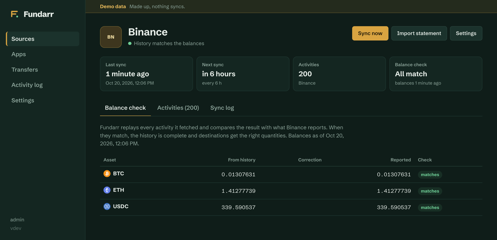
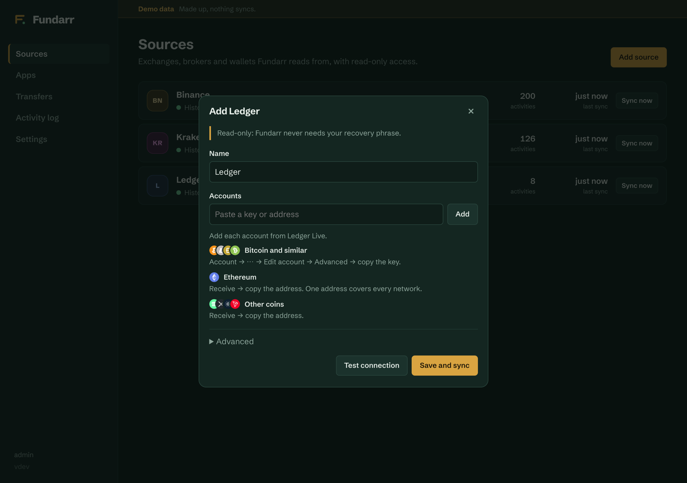
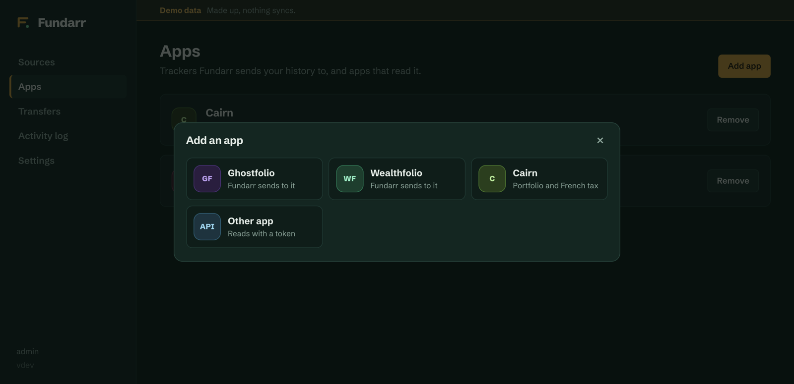
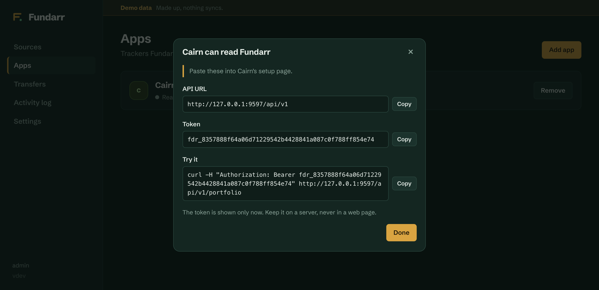

<p align="center">
  
</p>

<h1 align="center">Fundarr</h1>

<p align="center">
  <strong>Prowlarr for your money.</strong><br>
  Your exchanges and wallets, read once, checked, and sent to the apps you use.
</p>

<p align="center">
  <a href="https://github.com/Alexis-Marcel/fundarr/actions/workflows/ci.yml"></a>
  <a href="https://github.com/Alexis-Marcel/fundarr/pkgs/container/fundarr"></a>
  <a href="LICENSE"></a>
</p>

<p align="center">
  
</p>

Paid portfolio apps sell this sync. Fundarr is free, self-hosted, and your keys never leave your server.

- **Sources**: Binance, OKX, Kraken, Coinbase, Bitpanda, Interactive Brokers, Trade Republic, and any wallet (Ledger, Trezor, MetaMask, Phantom…), all read-only.
- **One checked history**: Fundarr replays it against the real balances, fills the gaps APIs leave, and pairs transfers between your accounts.
- **Apps**: Wealthfolio and Ghostfolio receive it after every sync; Cairn, Koinly or your own app read it.

## Quick start

**1. Run it**

```sh
docker compose up -d   # with the compose.yaml of this repo
```

or `docker run -d -p 9494:9494 -v fundarr:/data ghcr.io/alexis-marcel/fundarr`. It is one small container (a Go binary and a SQLite file) and runs on a Raspberry Pi.

**2. Add a source.** Open http://localhost:9494, create your account, then **Sources → Add source**. Each form shows how to create a read-only key.

**3. Connect an app.** **Apps → Add app**: Wealthfolio, Ghostfolio, Cairn, or any other app.

Just looking? `docker run --rm -e FUNDARR_DEMO=1 -p 9494:9494 ghcr.io/alexis-marcel/fundarr` serves a made-up portfolio, no account needed.

<table>
  <tr>
    <td width="50%"><br><sub>Every source is checked against its real balances.</sub></td>
    <td width="50%"><br><sub>Wallets: a guide per app, every account in one source.</sub></td>
  </tr>
  <tr>
    <td><br><sub>Apps Fundarr sends to, and apps that read it.</sub></td>
    <td><br><sub>Any app connects with an address and a token.</sub></td>
  </tr>
</table>

## Sources

| | |
|---|---|
| **Binance** | Since 2017: trades, converts, Auto-Invest, card purchases, Earn and staking, Pay, P2P. Import the export once to fill what the API forgot. |
| **OKX** | Since 2021, older trades from OKX's archives. |
| **Kraken** | The whole ledger. |
| **Coinbase** | The whole history, Advanced Trade included. |
| **Bitpanda** | Crypto, stocks and ETFs, metals, savings plans. |
| **Interactive Brokers** | Trades, dividends, cash, transfers and corporate actions through the official Flex Web Service. |
| **Trade Republic** | Compte-titres, PEA and crypto: import the CSV export, or Connect (beta) and sync with one tap, approved in the app. |
| **Wallet** | Bitcoin, Litecoin, Dogecoin, Bitcoin Cash, Ethereum and EVM chains, Solana, Tron, Cardano, XRP. Paste a public key or an address, never a recovery phrase. |

Details and limits per platform: [docs/sources.md](docs/sources.md).

## Apps

| App | How |
|---|---|
| [Wealthfolio](https://wealthfolio.app) | Fundarr sends new activities after every sync, through Wealthfolio's MCP endpoint (`WF_MCP_ENABLED=true` and an access token). |
| [Ghostfolio](https://ghostfol.io) | Fundarr sends new activities through its import API, with your security token. |
| [Cairn](https://github.com/Alexis-Marcel/cairn) | Reads Fundarr: where your crypto stands, its progress, and the French tax form 2086. |
| Koinly, spreadsheets | Download the history as CSV (**Settings → Export**), in Fundarr's or Koinly's format. |
| **Your own app** | Reads the API with a token. |

### Your own app

**Apps → Add app → Other app** gives an address and a token:

```sh
curl -H "Authorization: Bearer fdr_…" http://localhost:9494/api/v1/portfolio
```

The read API serves every activity, the holdings, the portfolio and its history, and the French 2086 form, already computed. An app with its own database stays in sync through a changes feed (`/api/v1/changes`, with an optional notification), and a Go app can reuse Fundarr's cost, portfolio and tax code (`pkg/`). Develop against the demo (`FUNDARR_DEMO=1`, token `fdr_demo`). Start with [Build an app](docs/build-an-app.md); the full contract is in [api.md](docs/api.md) and [openapi.yaml](docs/openapi.yaml). Cairn is a complete example.

## What Fundarr does

- **Balance check**: the history is replayed and compared with what each platform reports, asset by asset.
- **Corrections**: what an API forgot becomes a correction valued at that day's price, held 48 hours in case the history catches up.
- **Statements**: a platform's own export replaces the corrections with the real trades.
- **Transfers**: a withdrawal and the deposit it became are paired, so apps see a move at cost, not a sale.
- **Prices**: daily prices and exchange rates from public data, no key needed.
- **Delivery**: each activity is sent once; failures are retried.

More in [How it works](docs/how-it-works.md).

## Versions

Releases are tagged (`v0.1.0`) and published as images with the same tag (`ghcr.io/alexis-marcel/fundarr:0.1`); `latest` follows `main`. The API stays compatible within `/api/v1` ([details](docs/api.md#stability)); [release notes](https://github.com/Alexis-Marcel/fundarr/releases).

## Configuration

None is needed. Sign-in (password, OpenID Connect, reverse proxy), the data folder and the other settings are in [docs/configuration.md](docs/configuration.md). Back up `/data` whole: it holds the database and the key that encrypts your API keys.

## Security

- Use **read-only** keys. Fundarr refuses a key it can tell allows trading or withdrawals.
- Keys are encrypted at rest (AES-256-GCM) and never sent back to the browser.
- Restrict keys to your server's IP when the platform allows it.
- Keep Fundarr behind your VPN or SSO; it does not need to be public.

## Develop

```sh
go test ./...
FUNDARR_DEMO=1 go run ./cmd/fundarr       # API on :9494
cd web && npm install && npm run dev      # UI on :5173, API proxied to :9494
```

A new source or app is one Go package: see [CONTRIBUTING.md](CONTRIBUTING.md).

## License

[AGPL-3.0](LICENSE). If you run a modified Fundarr for others, share your changes.

Coin icons come from [cryptocurrency-icons](https://github.com/spothq/cryptocurrency-icons) (CC0) and ship with Fundarr, so no third party learns which coins you hold.
